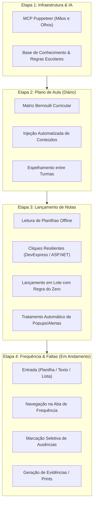

# Ecossistema de Automação TOTVS: Da Burocracia ao Assistente Operacional

Este documento detalha todas as etapas do ecossistema de automação desenvolvido para o sistema TOTVS (Colégio/Bernoulli). Ele serve como um mapa mental, roteiro estruturado e base conceitual para visualização do escopo e replicação/explicação clara para outros professores.

---

---

## 📌 Etapa 1: Preparando o Terreno (Infraestrutura e IA)
> *Antes de o robô começar a clicar, precisamos dar "mãos", "olhos" e "conhecimento" a ele.*

* **Ativação do Servidor MCP (Puppeteer):**
  * Habilitação do *Model Context Protocol* (MCP) integrado com o Puppeteer.
  * A IA deixou de ser um chatbot estático e passou a controlar ativamente uma instância do navegador: navegação visual, cliques, preenchimento de inputs e extração do DOM.
* **Criação de Conhecimento Base:**
  * Documentação viva (`Manual_Automacao_TOTVS.md` e Skills especializadas).
  * Contextualização da rotina pedagógica: matriz curricular de Física/Práticas de Física, códigos de turma (ex.: 103D, 104D, 203, 204, 205, 207) e regras de espelhamento.

---

## 📌 Etapa 2: Automatizando a Burocracia (Diário de Classe)
> *O primeiro grande desafio de interação com o sistema.*

* **Automação do Plano de Aula:**
  * Mapeamento da ementa e cronograma oficial Bernoulli.
  * Formatação automática no padrão: `[Código do Capítulo]: [Título] - [Subtópico ou Abordagem]`.
  * Criação do padrão pedagógico "Sanduíche de Avaliações" (*Aula Anterior: Revisão* $\rightarrow$ *Aula do Dia: Aplicação* $\rightarrow$ *Aula Seguinte: Correção e Comentários*).
* **Preenchimento e Replicação:**
  * Scripts de injeção direta no diário de classe contornando recarregamentos assíncronos.
  * Utilização do recurso nativo do TOTVS para espelhar conteúdos entre turmas paralelas de forma instantânea.

---

## 📌 Etapa 3: Domínio do Lançamento de Notas
> *A etapa mais complexa, envolvendo dados sensíveis e instabilidades do sistema legado.*

* **Integração com o Excel:**
  * Leitura de notas geradas offline pelo professor, sem necessidade de digitação manual na tela web.
* **Drible no Framework DevExpress (TOTVS):**
  * O sistema utiliza componentes ASP.NET/DevExpress com `UpdatePanels` que disparam callbacks e recarregam estados do servidor.
  * **Solução:** Em vez de manipular `SelectedIndex` de forma invisível (o que causava erro `Object reference not set to an instance of an object`), implementamos **Cliques Resilientes Reais** (`puppeteer_click` na ordem: abrir dropdown $\rightarrow$ aguardar callback $\rightarrow$ selecionar etapa $\rightarrow$ selecionar avaliação $\rightarrow$ selecionar botão de confirmação).
* **Injeção de Dados em Lote & Regra do Zero:**
  * Cruzamento automático entre o nome na planilha e a linha correspondente na tabela da tela.
  * **Regra do Zero:** Conversão de nota `0` em campo vazio no TOTVS para proteger alunos ausentes ou sem nota lançada.
  * Espelhamento de notas entre disciplinas complementares (Física e Práticas de Física).
* **Bloqueador de Alertas:**
  * Supressão/confirmação imediata de modais de alerta (*"Digitação efetuada com sucesso"*), garantindo execuções longas sem travamentos.

---

## 📌 Etapa 4: Frequência e Faltas (O Próximo Passo)
> *A fundação está pronta para a próxima fase do projeto (Etapa 3 escolar).*

* **Entrada de Frequência:**
  * Recepção de dados flexível: planilhas de chamada, relatórios em texto ou marcações offline por aula/data.
* **Navegação & Lançamento:**
  * Acesso à aba de **Frequência** no TOTVS por turma, data e horário correspondente.
  * Marcação focada exclusivamente nos alunos ausentes (otimização de cliques e menor tempo de execução).
* **Auditoria e Segurança:**
  * Verificação pós-lançamento com captura de tela (print/comprovante) para conferência e arquivo do professor.

---

## 🚀 Resumo do Ecossistema

O projeto evoluiu de um script pontual para um **Assistente Operacional sob medida**:

1. **Professor:** Preenche seus dados de notas, frequência ou planejamento no Excel de forma offline e confortável.
2. **IA (Jarvis):** Assume a operação no navegador — faz login assistido, seleciona turmas e etapas, executa cliques resilientes e lança os dados.
3. **Auditoria:** Emite log de execução e captura de tela de confirmação, garantindo 100% de confiabilidade e transparência.
